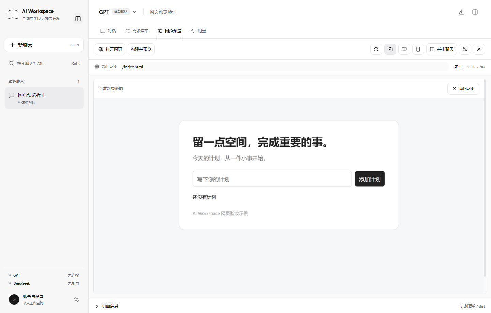

# AI Workspace

面向个人 Windows 10/11 电脑的 AI 编程工作台。GPT 负责对话、设计、任务分派和验收，DeepSeek 负责执行代码、文件和开发工具任务。

**当前版本：0.7.0。** 本仓库保存已经实现的版本；完整后端、数据库服务管理等后续需求见 [ROADMAP.md](ROADMAP.md)。

[下载 Windows 安装包](https://github.com/AAAQB/AI-Workspace/releases/tag/v0.7.0) · [使用与开发说明](outputs/AI-Workspace/README-使用与开发.txt) · [验证摘要](docs/VALIDATION.md)

截图来自独立测试项目，未使用个人账号数据。

## 已有功能

- 默认由 GPT 与用户对话；明确要求开发后，再安排 DeepSeek 执行。
- GPT 可提供关键设计和代码，并根据真实执行结果要求返工或完成交付。
- 选择题、需求清单、阶段汇报、真实任务进度和按需展开的执行详情。
- 项目文件管理、修改前恢复点、本地历史记录、操作审批、任务排队与暂停恢复。
- GPT 和 DeepSeek 的模型、思考强度分别手动选择并保存。
- 内置网页预览，支持静态网页和构建后的前端、截图、页面报错、点击、填写、手机尺寸和并排聊天。
- DeepSeek 流式连接诊断、分类重试、上下文整理和合并最终验收。

## 使用

1. 在 [Releases](https://github.com/AAAQB/AI-Workspace/releases) 下载当前 Windows x64 安装包；升级前关闭旧版窗口。
2. 在“账号与设置”中通过官方 Continue with ChatGPT 授权，并选择可用模型。能否使用取决于账号及官方开放范围。
3. 需要开发时，在设置中保存自己的 DeepSeek API Key，并为聊天选择项目文件夹。
4. 向 GPT 明确提出制作或修改要求。重要操作由用户审批。
5. 查看项目网页时打开“网页预览”；需要构建的前端项目可选择“构建并预览”。

凭据只在软件设置或官方授权界面中输入，不要提交到仓库、Issue 或聊天记录中。

## 当前边界

0.7.0 的内置浏览器覆盖静态页面和前端构建产物。完整后端服务、本地数据库服务、服务端渲染和本地 API 的自动运行与整体验收尚未实现。当前版本限制预览访问其他本地服务、电脑文件、外部导航和公网写入请求。

软件使用项目内的受限命令运行环境；访问项目外位置、删除已有文件、系统工具安装、上传和发布等操作需要授权。GPT 授权或额度不可用时保留进度，不自动切换到额外付费的 OpenAI API，也不使用非官方 Cookie 或密码登录。

## 从源码构建

保留本仓库的目录结构，在 Windows 上安装 Node.js 22 或更新的兼容版本，然后在 PowerShell 中执行：

~~~powershell
cd outputs/AI-Workspace
npm ci
npm run typecheck
npm run build
npm start
~~~

生成安装包：

~~~powershell
npm run package
~~~

安装包输出到仓库根目录的 work/final-release。首次构建会下载 Electron 和 NSIS 构建组件；原生命令运行辅助程序由 Windows 的 .NET Framework C# 编译器构建。

运行常规检查：

~~~powershell
npm test
~~~

Python 和联网依赖安装检查需要显式启用。scripts/live-* 是可选的真实模型验收脚本，会使用本机已有授权并消耗模型额度或 API 费用，不属于默认测试，也不会在克隆或安装时自动运行。

## 仓库结构

~~~text
outputs/AI-Workspace/   应用源码、测试、构建脚本及第三方组件
docs/                  公开说明、验证摘要和测试界面截图
work/                  本地构建及测试目录，不提交
~~~

安装包、原始源码压缩包、使用说明和 SHA-256 校验文件放在版本发布页。账号凭据、聊天记录、个人项目、运行数据库和测试运行目录不包含在本仓库中。

## 许可与来源

主项目保留当前 package.json 中的 UNLICENSED 标记。第三方组件保留各自的许可证和来源说明。

随附 Sign in with ChatGPT DevKit 使用其 Noncommercial License v1.0；本地响应类型及序列化扩展已标记修改并保留相同许可。详见 [LICENSE-NOTICES.txt](outputs/AI-Workspace/LICENSE-NOTICES.txt)、[DevKit 许可证](outputs/AI-Workspace/vendor/siwc/LICENSE) 和 [本地修改说明](outputs/AI-Workspace/vendor/siwc/AI-WORKSPACE-CHANGES.txt)。

本软件独立开发，与 OpenAI、DeepSeek 无隶属关系。
